# vartalap (वार्तालाप)

A resilient, durable real-time messenger built with a proven database-backed spine and an optimistic client interface.

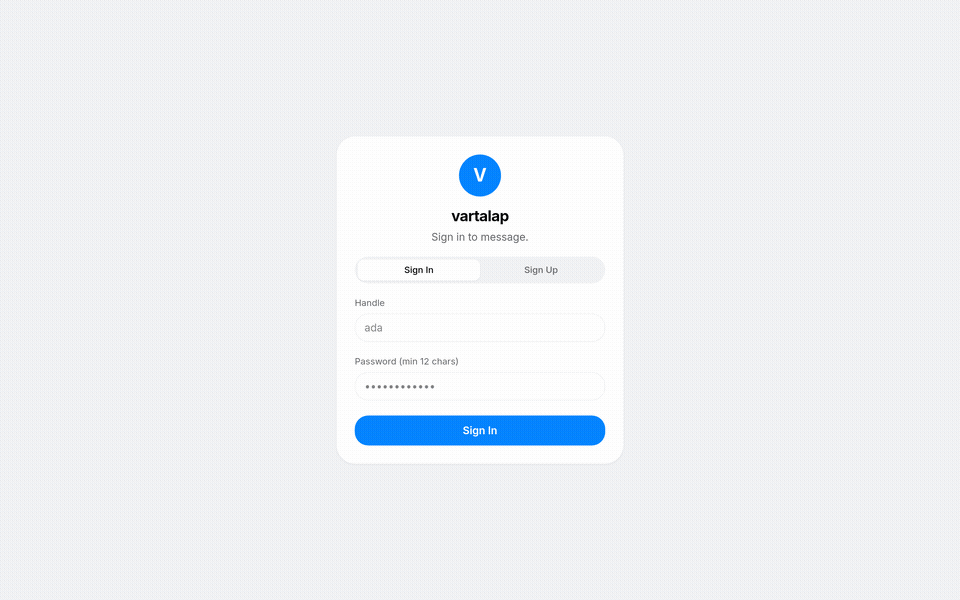

> **Live Video:** Watch the full HD demonstration walkthrough: [media/demo.mp4](media/demo.mp4).

---

## Architecture & System Design

vartalap decouples message persistence from network fan-out. Every message is guaranteed strict monotonic ordering via database-level serialization locks, committed locally before network transit, and broadcast via an asynchronous transactional outbox relay.

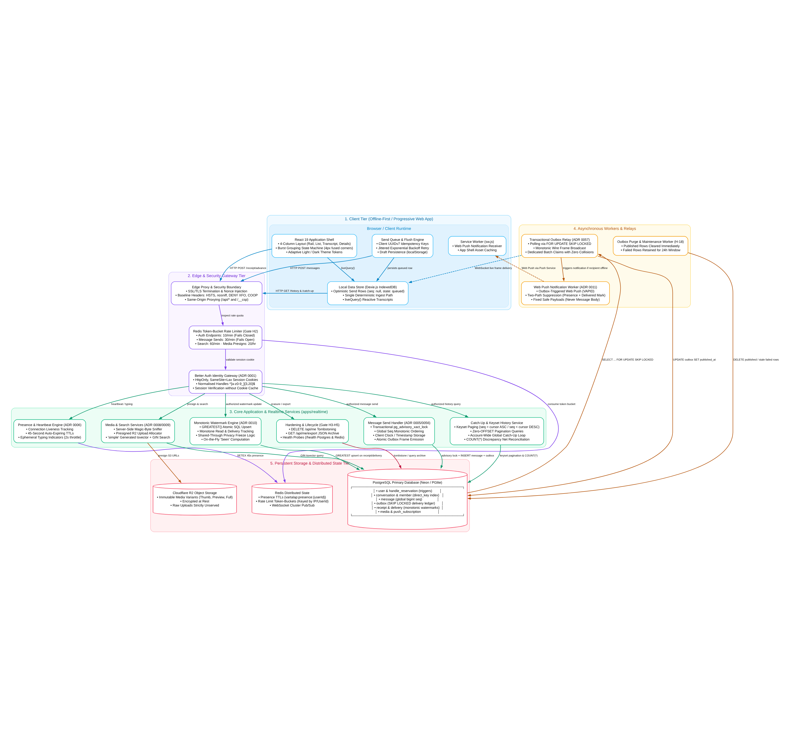

### System Component Architecture

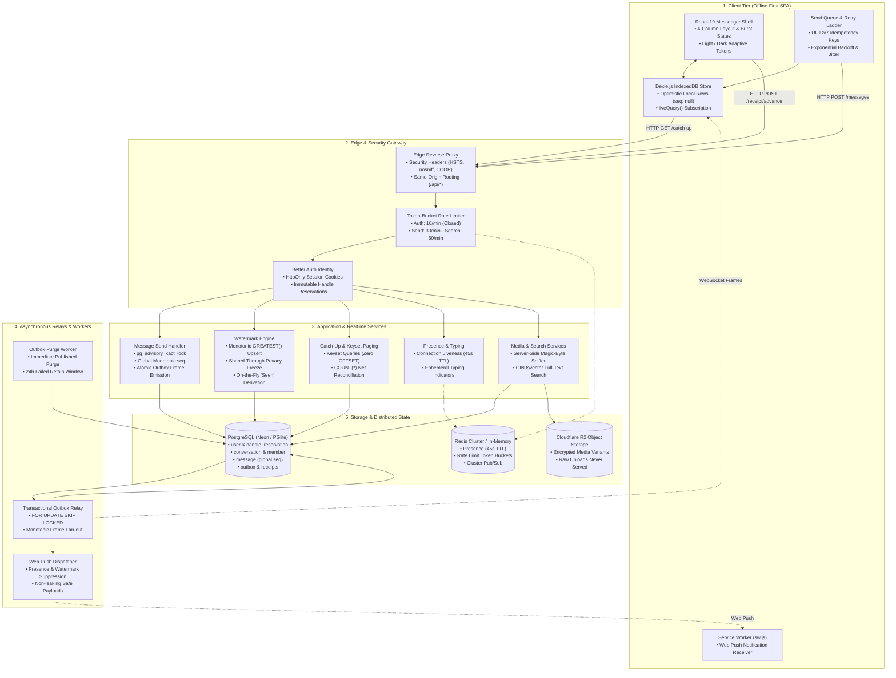

### End-to-End Transaction & Relay Flow

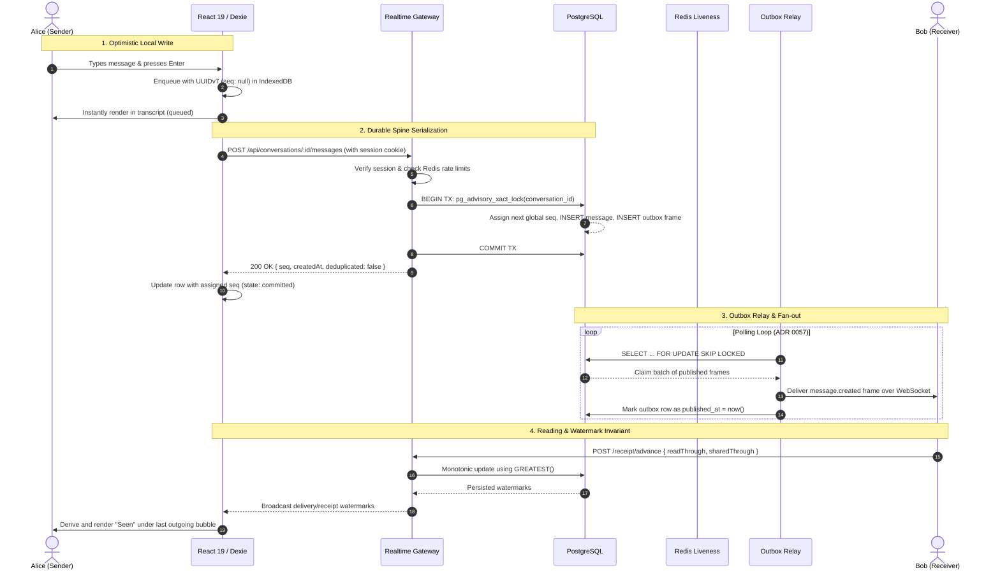

---

## Core Capabilities & Features

### 🚀 Durable Message Pipeline
- **Strict Monotonic Ordering:** Inside every conversation, commit order equals sequence order (`seq`). Race conditions and clock drift cannot invert message delivery thanks to transaction-scoped advisory locks (`pg_advisory_xact_lock`).
- **Persist-Before-Acknowledge:** Every message mints a client-side UUIDv7 idempotency key. Messages are written to local Dexie IndexedDB storage first (`position: null`) and sent with automatic jittered exponential backoff on retry.
- **Single Deterministic Receive Path:** Incoming WebSocket frames, catch-up pagination queries, and local own-message echoes pass through the exact same ingest handler, preventing duplicates or out-of-order race conditions.

### 👁️ Presence, Liveness & Receipts
- **Derived "Seen" Indicator:** "Seen" state is computed per render rather than stored as a mutable database column. It appears if and only if all active peers have acknowledged receipt past the message's sequence number.
- **Privacy-Preserving Freeze:** Disabling read receipts freezes `shared_through` while allowing `read_through` to advance privately, preventing reading history leaks.
- **Connection Liveness on Redis:** User presence is backed by a 45-second Redis connection TTL refreshed on socket heartbeat—never relying on fragile client polling timers.

### 🛡️ Enterprise Hardening (Gate 1)
- **Security Headers:** Enforces strict security baselines across all HTTP responses: `Strict-Transport-Security`, `X-Content-Type-Options: nosniff`, `X-Frame-Options: DENY`, `Referrer-Policy: no-referrer`, `Permissions-Policy`, and `Cross-Origin-Opener-Policy: same-origin`.
- **Redis Token-Bucket Rate Limiter:** Protects against abuse with granular limits: Auth endpoints (10/min, fails closed), Send endpoints (30/min, fails open), Search queries (60/min), and Upload presigning (20/hr).
- **GDPR Compliance (Erasure & Export):** `DELETE /api/me` anonymizes user accounts into permanent tombstones (`tombstone-<id>@deleted.invalid`), reserving handles forever while preserving conversation transcript integrity. `GET /api/me/export` provides full on-demand JSON export of profile and authored content.

### 🖼️ Media & Full-Text Search
- **Magic-Byte Sniffing Pipeline:** Uploaded media undergoes server-side magic number byte sniffing (PNG, JPEG, GIF, WebP). Raw uploads are stored encrypted in Cloudflare R2 and never served directly to clients.
- **Server-Side Full-Text Search:** High-performance message search powered by PostgreSQL `'simple'` dictionary `tsvector` generated columns, GIN indexes, and 3-character trigram guards.

### 🎨 Fluid Responsive UI
- **Design Tokens & Theme Switcher:** Fully responsive 4-column layout (Rail, Conversation List, Transcript, and Details Pane) styled with Tailwind CSS v4 tokens, supporting System, Light, and Dark mode palettes.
- **Bubble Bursts:** Smart message burst algorithm fuses bubble corners (4px radius) for consecutive messages from the same sender within 20-minute windows.
- **Collapsible Panes:** Distraction-free focus mode with collapsible sidebars and full mobile viewport responsiveness (<760px auto-switching).

---

## Visual Tour

| 01. Authentication | 02. Welcome & Direct Messaging |
|:---:|:---:|
| 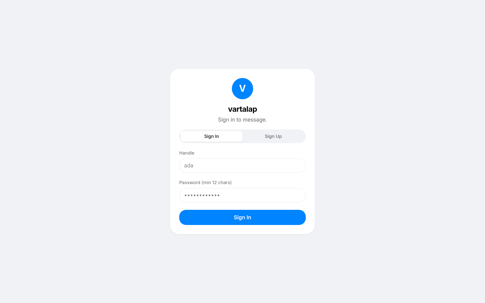 | 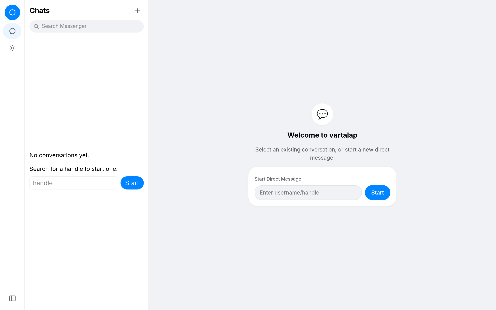 |
| *Sign In & Sign Up with immutable handle reservations* | *Navigation rail & direct chat initialization* |

| 03. Active Conversation | 04. Chat Transcript & Bubble Bursts |
|:---:|:---:|
| 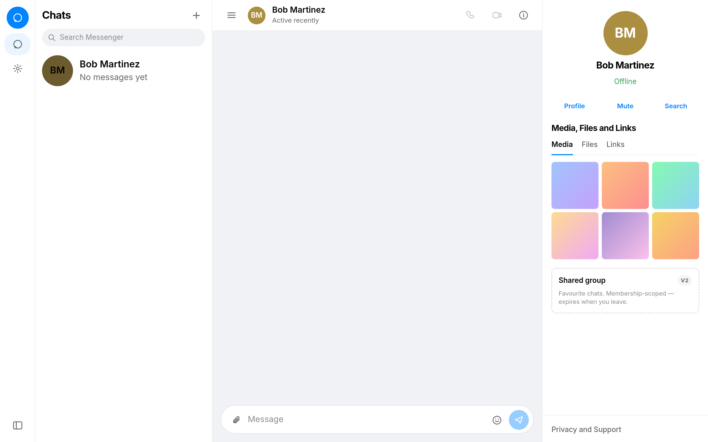 | 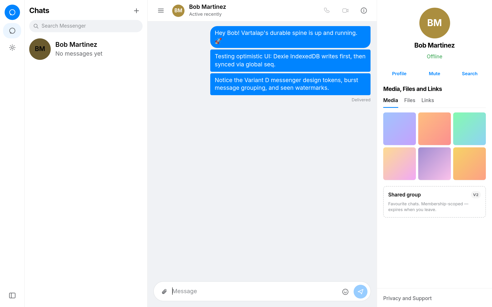 |
| *Presence indicators, conversation header, and composer* | *Monotonic sequencing, fused bubble corners, timestamps* |

| 05. Conversation Details Pane | 06. Account & System Settings |
|:---:|:---:|
|  | 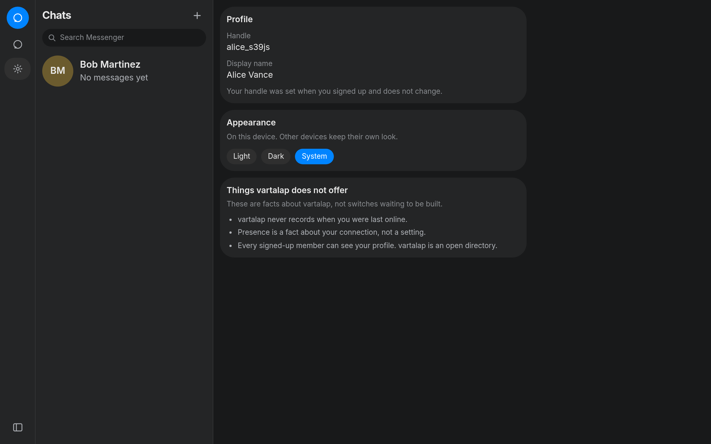 |
| *Participant roster, mute states, and watermark disclosures* | *Profile handles, device themes, and privacy toggles* |

| 07. Dark Mode Settings | 08. Dark Mode Transcript |
|:---:|:---:|
| 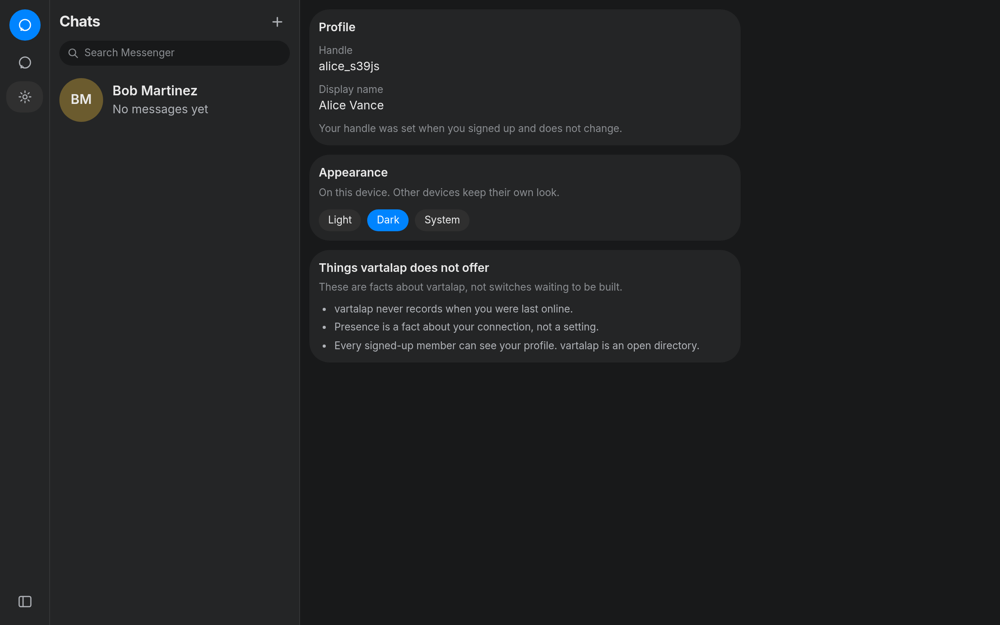 | 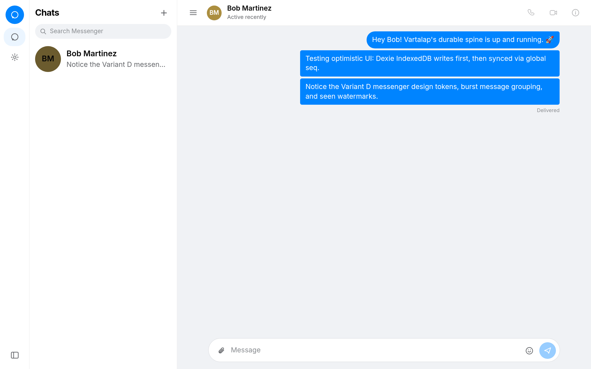 |
| *High-contrast accessibility tokens in dark palette* | *Immersive dark messenger transcript view* |

| 09. Focused / Collapsed View |
|:---:|
| 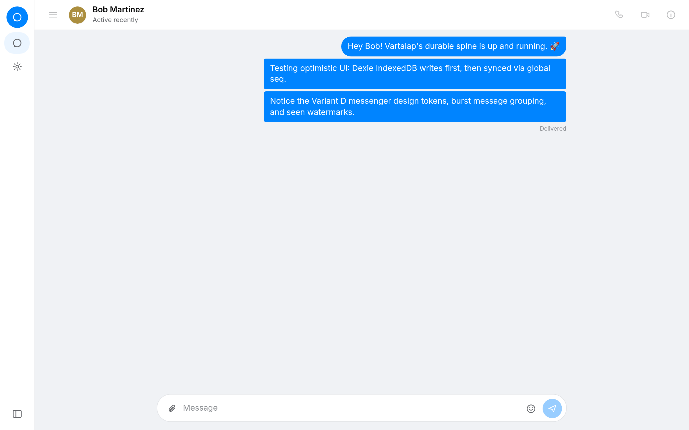 |
| *Focus mode with collapsed conversation list and rail* |

---

## Performance & Operational Characteristics

| Metric | Measured Value | Implementation Guarantee |
|:---|:---:|:---|
| **Local Message Enqueue** | `< 1ms` | Synchronous write to client Dexie IndexedDB before network dispatch |
| **Commit Ordering Overhead** | `~0.3ms` | Lightweight `pg_advisory_xact_lock` hash serialization |
| **Presence Heartbeat Check** | `< 2ms` | Redis single-key `MGET` / `SETEX` with 45s TTL |
| **Outbox Relay Concurrency** | Non-blocking | Multi-worker parallel processing via `FOR UPDATE SKIP LOCKED` |
| **Watermark Updates** | `O(1)` | Monotonic database upsert via `GREATEST(stored, reported)` |
| **Test Suite Verification** | **429 Passed** | 44 test files covering protocol, auth, database, realtime, and UI |

---

## Monorepo Structure

```
vartalap/
├── apps/
│   ├── web/               # React 19 SPA, Tailwind CSS v4, Dexie IndexedDB data layer
│   └── realtime/          # Bun HTTP router, WebSocket fan-out, spine endpoints, outbox relay
├── packages/
│   ├── database/          # Drizzle ORM schema, migrations, connection pool, test harness
│   ├── protocol/          # Shared Zod schemas, wire frames, error envelopes, scalar types
│   └── auth/              # Self-hosted Better Auth with PostgreSQL adapter & handle triggers
├── docs/
│   ├── adr/               # Architecture Decision Records (ADRs 0001–0065)
│   └── concepts/          # Deep-dive concept documents (durability, ordering, receipts)
├── media/                 # Screenshots, live GIF demonstration, and architecture diagrams
└── scripts/
    ├── db-local.ts        # Zero-docker PGlite Postgres server with pg_trgm & pgcrypto
    └── e2e-drive.ts       # Headless Chromium end-to-end automation driver
```

---

## Getting Started

### Prerequisites

- [Bun](https://bun.sh/) (>= 1.4.0)
- [Redis](https://redis.io/) (running locally on port `6379`)
- [Chromium](https://www.chromium.org/) & [FFmpeg](https://ffmpeg.org/) *(optional, for running e2e test recording)*

### Quickstart

1. **Clone and install dependencies:**
   ```bash
   git clone https://github.com/paramcodes/vartalap.git
   cd vartalap
   bun install
   ```

2. **Initialize local database & run migrations:**
   ```bash
   bun run db:setup
   ```

3. **Start the development services:**
   ```bash
   # Terminal 1: Local Postgres (PGlite on port 5433)
   bun run db:local

   # Terminal 2: Realtime API service (port 3000)
   bun run realtime

   # Terminal 3: Web frontend (Vite dev on port 5173)
   bun run dev
   ```

4. Open [http://localhost:5173](http://localhost:5173) in your browser.

---

## Development & Testing

### Running the Test Suite

Run all 429 unit and integration tests across every monorepo package:

```bash
bun test
```

### Static Typechecking

Verify TypeScript across all applications and packages:

```bash
bun run typecheck
```

### Automated E2E Verification & Screen Recording

Launch the full headless browser orchestration driver to simulate real user interactions, verify features, and record output:

```bash
bun run e2e:drive
```

---

## Contributing

1. Check open issues and consult [`docs/adr/`](docs/adr/) before proposing structural changes.
2. Ensure every new feature comes with automated tests.
3. Verify that `bun test` and `bun run typecheck` pass before submitting pull requests.
4. Follow Conventional Commits (`feat:`, `fix:`, `docs:`, etc.) with subject lines under 72 characters.

---

## License

[MIT](LICENSE)
